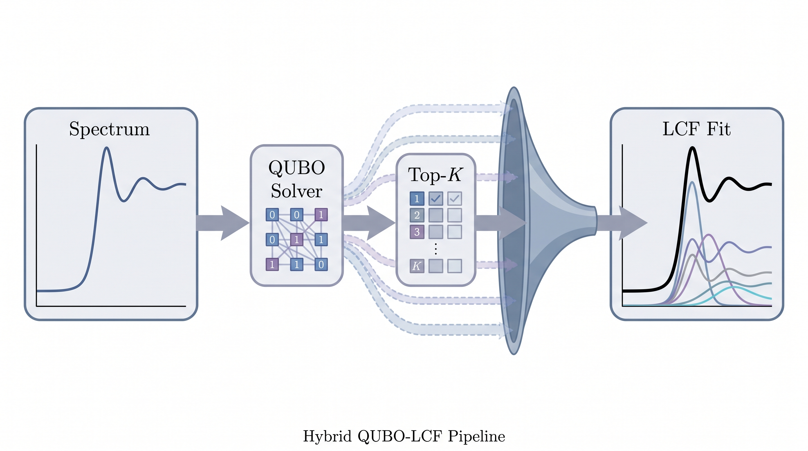
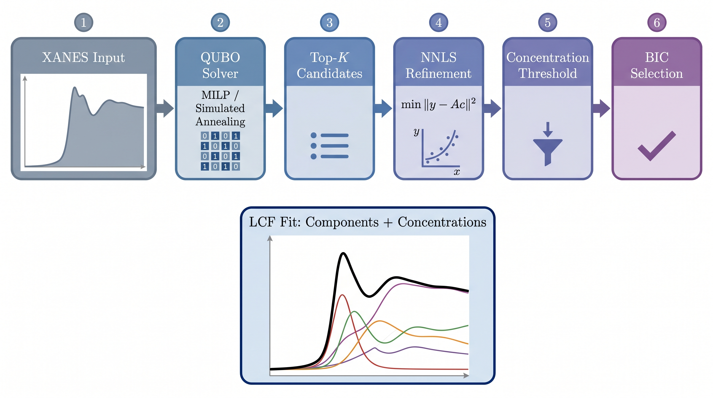

# **QUBIC**

**QUBIC** is a hybrid QUBO–LCF method for sparse linear-combination fitting of
spectra: it maps component *selection* onto a QUBO (quadratic unconstrained
binary optimization) problem, solves it with off-the-shelf combinatorial
solvers under a fixed time budget, and then refines the surviving candidates
with continuous non-negative least squares and BIC model selection.
`qubic-lcf` is just the repository/package name — the method itself is called
**QUBIC**.


*Graphical abstract of the **QUBIC** paper: hybrid QUBO–LCF pipeline (spectrum → QUBO solver → top-K → LCF fit).*


*The 6-stage **QUBIC** pipeline: XANES input → QUBO solver (MILP/SA) → top-K candidates → NNLS refinement → concentration threshold → BIC selection → LCF fit.*

## About

**QUBIC** solves the discrete model-selection step of linear combination
fitting (LCF) exactly where classical continuous relaxations fail: when
reference spectra are strongly correlated and the combination space is huge.
It encodes subset selection as a QUBO over binary variables, delegates the
search to any QUBO solver, and keeps a full statistical pipeline (NNLS
refinement, concentration thresholding, BIC) around it. The result is a
ranked list of top-K candidate supports with fitted concentrations.

## Scope

**QUBIC** was developed for LCF and NMR, and spectroscopy in general, but it
is applicable to **any** sparse regression / sparse decomposition task with
strong component correlation, noise, and a very large combination space.

## What is LCF?

Linear combination fitting models a measured spectrum $y \in \mathbb{R}^M$ as
a non-negative mixture of $N$ reference spectra (the columns of the
$M \times N$ matrix $A$):

$$y = A c + \varepsilon,$$

where $c \ge 0$ is the vector of concentrations and $\varepsilon$ is noise.
The goal is to choose a **support** $S \subseteq \{1, \dots, N\}$ — the subset
of components that actually participate in the mixture — with $|S| \le k_{\max}$,
and non-negative concentrations $c_S \ge 0$ that minimize the squared residual
norm

$$\min_{S,\; c_S \ge 0} \; \bigl\| y - A_S c_S \bigr\|_2^2,$$

equivalently minimizing the R-factor. Here $A_S$ is the submatrix of $A$
restricted to the columns in $S$.

For multi-edge NMR the same criterion is summed over edges $e$ with weights
$w_e$:

$$\min_{c \ge 0} \; \sum_e w_e \, \bigl\| y_e - A_e c \bigr\|_2^2.$$

## Why a QUBO?

The difficulty is combinatorial. Brute-force full enumeration requires

$$\sum_{k=1}^{k_{\max}} \binom{N}{k} \;\approx\; 2^N$$

subset checks — for the real case $N = 324$ this is astronomically infeasible
(about $10^{97}$ combinations) — and **each** candidate requires a
least-squares refit on top of that.

**QUBIC** maps the selection problem to a QUBO over $N \times B$ binary
variables (e.g. $2N$ variables for the 2-bit encoding), which any QUBO solver
can optimize under a fixed time budget. The worst case is still NP-hard, but
the budget-bounded search is tractable in practice and returns top-K candidate
supports. The exact exhaustive oracle is kept only for $N \le 15$.

## Encodings

The registry `SCHEMES` provides one encoding per key; each encodes subset
selection with a different number of binary variables per component and
different penalty structure.

| Key          | Variables / component | Description                                          |
|--------------|-----------------------|------------------------------------------------------|
| `B1`         | 1                     | one-hot selector                                     |
| `B2`         | 2                     | 2-bit encoding                                       |
| `B3`         | 3                     | one-hot triplet (unlinked)                           |
| `B4`         | 4                     | one-hot quartet (unlinked)                           |
| `linked_B2`  | 3                     | selector + residue bits, linked encoding             |
| `linked_B3`  | 4                     | selector + residue bits, linked encoding             |
| `linked_B4`  | 5                     | selector + residue bits, linked encoding             |

## Solvers

Each solver is a class bundling its own settings; an instance is passed
whole to `task.solve(...)` — uniformly for the QUBO and the alternative
backend. Backends are imported lazily; only the solver you run needs its
optional dependency installed.

| Class      | Key      | Backend                                        | Optional dependency |
|------------|----------|------------------------------------------------|---------------------|
| `MILP`     | `milp`   | MILP (CBC via PuLP)                            | `pulp`              |
| `HiGHS`    | `highs`  | HiGHS via PuLP (CBC fallback)                  | `pulp`              |
| `CP_SAT`   | `cp_sat` | OR-Tools CP-SAT                                | `ortools`           |
| `SCIP`     | `scip`   | SCIP via PySCIPOpt                             | `pyscipopt`         |
| `SA`       | `sa`     | simulated annealing                            | `dimod`             |
| `Tabu`     | `tabu`   | tabu search                                    | `dimod`, `dwave-tabu` |
| `GPU_SA`   | `gpu_sa` | GPU simulated annealing (CUDA)                 | `torch` (CUDA)      |
| `SQAOD`    | `sqaod`  | simulated quantum annealing                    | `sqaod` (optional)  |
| `QAOA`     | `qaoa`   | QAOA                                           | `qubo-lib` (optional) |

### Penalties and thresholds: `lambdas` and `tau`

The QUBO penalty coefficients are configurable per solver through
`lambdas` — either a constant dict or **a callable of the data**, so the
penalties can scale with the spectrum instead of being hard-coded:

```python
# constant penalties
res = task.solve(qubic.MILP(lambdas={"lam_sparse": 0.5, "lam_link": 2.0}))

# spectrum-dependent penalties: proportional to ||y||^2
def penalties(A, y):
    scale = float(y @ y)
    return {"lam_sparse": 0.01 * scale, "lam_link": 0.05 * scale}

res = task.solve(qubic.MILP(lambdas=penalties))
```

Allowed keys are encoding-specific (`lam_sparse` — cardinality penalty;
`lam_link` — selection/quantization link; `lam_antimix` — anti-mixing for
`B3`/`B4`); missing keys fall back to documented defaults. `tau`, the
concentration cutoff of the refinement stage, is a parameter of `Problem`
(refitted concentrations $\le \tau$ are trimmed from the reported support).

**Lazy semantics — "don't pay for what you don't use":** nothing is built
at `Problem` construction. A QUBO-backed solver builds the QUBO inside its
`solve` call only (memoized on the problem, so several QUBO solvers on the
same problem build it at most once); the alternative backend never triggers
any QUBO work.

## Alternative backend

In the paper, the greedy/lasso family — greedy forward selection (MP, OMP),
lasso+, top-k, and the oracle exact search for $N \le 15$ — is presented as
baselines. In this project, however, it is a fully functional **alternative
backend** to the QUBO solver, not merely a comparison point: it is typically
about an order of magnitude faster, but it can degrade on noisy, ill-defined
and strongly correlated cases. It is a legitimate part of the pipeline
(module `qubic.alternative`, entry point `run_all_alternative()`) and is
useful on its own.

## Installation

Core dependencies are `numpy`, `scipy` and `scikit-learn`. Solver backends
are optional extras.

```bash
pip install qubic-lcf
# or the latest development version:
pip install git+https://github.com/laosian314-del/qubic-lcf.git
```

Selective extras (solver backends are all optional; each is loaded lazily
only when you actually run it):

```bash
pip install "qubic-lcf[milp]"     # MILP via PuLP (CBC; also covers highs/HiGHS)
pip install "qubic-lcf[cpsat]"    # OR-Tools CP-SAT
pip install "qubic-lcf[scip]"     # PySCIPOpt
pip install "qubic-lcf[sa]"       # simulated annealing (dimod)
pip install "qubic-lcf[tabu]"     # tabu search (dwave-samplers)
pip install "qubic-lcf[sqaod]"    # simulated quantum annealing (sqaod)
pip install "qubic-lcf[gpu]"      # GPU simulated annealing (CUDA)
pip install "qubic-lcf[jit]"      # optional numba acceleration (see below)
pip install "qubic-lcf[all]"      # everything
```

`qaoa` needs no extra (it runs on `scipy` alone).

## Quickstart

A fully synthetic, self-contained example
([`examples/quickstart.py`](examples/quickstart.py)):

```python
import numpy as np
import qubic

# Synthetic reference library: 10 energy points, 5 candidate references.
np.random.seed(42)
A = np.random.rand(10, 5)              # non-negative reference spectra

# Ground-truth mixture: references 1 and 3 with concentrations 0.4 / 0.6.
true_idx = [1, 3]
true_conc = np.array([0.4, 0.6])
target = A[:, true_idx] @ true_conc + 0.01 * np.random.randn(10)

# 1. Describe the task once.
task = qubic.Problem(A, target, k_max=2, tau=0.01)

# 2. Pick a solver object (bundles its own settings) and run it.
res = task.solve(qubic.MILP(time_limit=30.0), top_k=10)
print("score        =", res.best_score)
print("support      =", res.best_support)
print("concentrations =", res.best_concentrations)
print("top_K        =", res.top_K)
print("stats        =", res.stats)

# 3. Any other solver plugs in identically.
res = task.solve(qubic.SA(restarts=20, T0=1.0))

# 4. The alternative backend uses the exact same interface.
res = task.solve(qubic.OMP())

# 5. Opt-in numba acceleration of the whole run (optional):
# res = task.solve(qubic.SA(restarts=20), use_jit=True)
```

The pipeline stage chain is: XANES input → QUBO solver (MILP/SA) → top-K
candidates → NNLS refinement → concentration threshold ($\tau$) → BIC
selection → LCF fit. The returned `Result` carries `selected`,
`concentrations`, `bic` (aliases `best_support`, `best_concentrations`,
`best_score`), the full `top_K` candidate list and per-run `stats`. The
low-level building blocks (QUBO construction, encodings, the solver
registry) remain available in the submodules for advanced use.

## Pyfitit integration

**QUBIC** can be used as a drop-in mixture-search backend for
[PyFitit](https://github.com/gudasergey/pyFitIt)-style workflows: the module
`qubic.pyfitit_api` exposes `tryallmixtures`, which mirrors
`pyfitit.mixture.tryallmixtures` but enumerates candidate mixtures with the
**QUBIC** pipeline instead of the built-in search.

```python
from qubic.pyfitit_api import tryallmixtures

result = tryallmixtures(A, target, scheme="B2", solver="milp",
                        top_k_values=(1, 10, 20))
```

See [`examples/pyfitit_integration.py`](examples/pyfitit_integration.py) for
a complete runnable example. **Pyfitit itself is optional** and is not a
dependency of `qubic-lcf`; install it separately only if you need the full
Pyfitit workflow. The core pipeline works without it.

## Repository layout

```
src/qubic/
    __init__.py          # public API (lazy facade)
    problem.py           # Problem + Result: the high-level task object
    solver.py            # Solver class hierarchy (QuboSolver + alternative)
    encodings.py         # SCHEMES registry: B1..B4, linked_B2..linked_B4
    qubo.py              # internal QUBO builder (lambdas: dict or callable)
    alternative.py       # alternative backend (replaces the former baselines.py)
    pipeline.py          # refinement: NNLS + tau cutoff + BIC selection
    pyfitit_api.py       # tryallmixtures (mirrors pyfitit.mixture.tryallmixtures)
    _accel.py            # lazy numba loading (opt-in use_jit)
    solvers/             # solver registry: milp, highs, cp_sat, scip, sa, ...
benchmarks/              # timing scripts: default path vs use_jit
examples/
    quickstart.py        # end-to-end synthetic example
    pyfitit_integration.py
tests/                   # pytest suite
docs/assets/             # figures
```

Note: `src/qubic/alternative.py` replaces `baselines.py`; the old name is no
longer used.

## Optional numba acceleration (not used in the article)

Every hot path has an **opt-in** numba-accelerated twin. The default path is
the pure-NumPy reference code and **never imports numba** ("don't pay for
what you don't use"); `use_jit=True` on a run switches the whole pipeline —
QUBO assembly, the solver's own kernel (SA/Tabu/QAOA) and the NNLS
refinement — to the accelerated kernels:

```python
res = task.solve(qubic.SA(restarts=20), use_jit=True)   # native numba SA kernel
res = task.solve(qubic.OMP(), use_jit=True)             # greedy kernels
```

Install it with `pip install "qubic-lcf[jit]"` (or just `pip install numba`).
Without numba, `use_jit=True` raises a clear `ImportError`. The twins are
numerically equivalent: the QUBO assembly and the greedy kernels are bitwise
identical between the two paths, the batched NNLS refinement matches
`scipy.optimize.nnls` to ~1e-8, and the QAOA state evolution matches the
`scipy.expm` reference to ~1e-11 (asserted in `tests/test_jit_*.py`).

**The numba/JIT acceleration was NOT used in the article** — all article
results were obtained with the pure NumPy code paths. Timings below were
measured on a single CPU core of the development machine (reproduce with the
scripts in `benchmarks/`):

- QUBO assembly (m=300 points, N=324 references, k=10): 2–3× over the
  vectorized default (≈6–12 ms → ≈3–5 ms across schemes). The vectorized
  reference path itself is 36–55× faster than the previous loop-based
  assembly.
- Native SA / tabu kernels (`use_jit=True`; they work without `dimod`):
  200–360× over their pure-NumPy twins at M=30–100 variables (kernel level);
  end-to-end `solve(..., use_jit=True)` ≈ 0.01–0.1 s at M=100.
- Greedy MP/OMP selection: 2–20× on the greedy-path kernels, 1.1–1.9×
  end-to-end (the shared BIC/NNLS refinement stage dominates at small sizes).
- Batched NNLS refinement (100 candidate supports): ≈2× over the
  per-candidate `scipy.optimize.nnls` loop (≈52 µs → 27–34 µs per candidate).
- QAOA: analytic parameterized gates + numba are 1.6–2.1× faster than the
  legacy `scipy.expm` evolution at n=10–12 qubits. The legacy evolution
  applied per-qubit 2×2 unitaries — not a full 2^n×2^n matrix exponential —
  so the win here is modest, not orders of magnitude.

The first `use_jit=True` call pays a one-time numba compilation cost
(~0.4–0.6 s per kernel signature, cached afterwards).

## Development

```bash
pip install -e ".[all]"
pytest
python benchmarks/bench_qubo_build.py   # default vs use_jit timings
```

## Links

- PyFitit: https://github.com/gudasergey/pyFitIt
- Pyfitit article: A. Martini, S. A. Guda, A. A. Guda, G. Yu. Smolentsev,
  A. Algasov, O. Usoltsev et al., "PyFitit: The software for quantitative
  analysis of XANES spectra using machine-learning algorithms",
  *Comput. Phys. Commun.* **250**, 107064 (2020),
  https://doi.org/10.1016/j.cpc.2019.107064
- This repository: https://github.com/laosian314-del/qubic-lcf
- The **QUBIC** article — in preparation.

## Citation

If you use this code, please cite the **QUBIC** article (in preparation).

## License

Released under the [MIT License](LICENSE).
